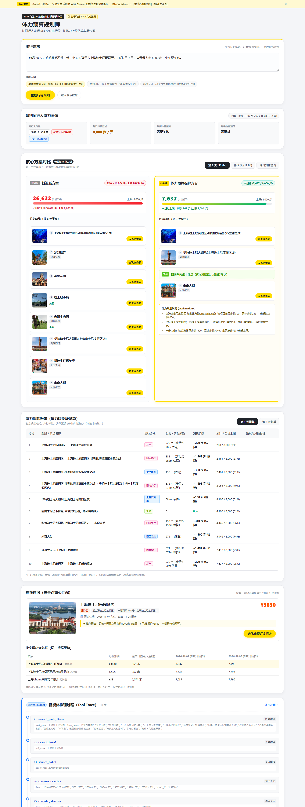

# Stamina Trip · 体力预算规划师



按同行人走得动多少来排行程。旅行实体、价格、坐标和链接均来自飞猪 flyai。

## 怎么工作

1. LLM 把一句话需求解析成画像（城市、日期、同行人、每日步数上限、午休、预算），字段经 Python 校验。
2. 智能体工具循环（`stamina/agent.py`，最多 12 轮）：模型按偏好调用 `search_poi`、`search_hotel`（飞猪实时数据），用 `compute_stamina` 试算，超限就换点再算，最后 `finalize`。
3. 步数只来自确定性函数（`stamina/stamina.py`）。`finalize` 会重新计算并拒绝：超步数上限、打车超 20 公里、排不进午休、夜游不在最后、未知或重复 id。模型自己报的数字一律不用。
4. 超轮数或模型出错时退回确定性规划（`planner.collect_and_plan`），结果记 `mode: "fallback"` 和原因；正常为 `mode: "agent"`，并带 `tool_trace`。
5. LLM 只解释已算好的结果，解释里没有景点简介依据的设施、环境、适用人群说法整句删除，记入 `removed_claims`。

## 网页

```powershell
python -m uvicorn stamina.server:app --host 127.0.0.1 --port 8000
# 浏览器打开 http://127.0.0.1:8000/
```

页面与 `/plan` 同源。打开时展示 `web/sample-plan.json`（一次真实接口输出），点击「生成行程规划」才实时调用模型和飞猪，通常 30–90 秒。页面上每个数字、名称、标签都来自返回 JSON 的字段。

## 运行

```powershell
npm i -g @fly-ai/flyai-cli
python -m pip install -r requirements.txt
Copy-Item .env.example .env
# 填写接口地址、模型、LLM_API_KEY、FLYAI_API_KEY
python -X utf8 -m stamina.cli "爸妈 68 岁，妈妈膝盖不好，带一个 6 岁孩子，杭州 11月7日-8日 两天，每天最多走 6000 步，中午要午休。"
```

产物为 `out/plan.md` 和 `out/plan.json`，与 `.env` 一起被 Git 忽略。模型走 OpenAI 兼容接口，换模型只改 `.env` 的 `LLM_BASE_URL`、`LLM_MODEL`、`LLM_API_KEY`；模型需支持 function calling。

```powershell
python -m uvicorn stamina.server:app --host 127.0.0.1 --port 8000
# 在另一个终端执行
$body = @{ query = '爸妈68岁，妈妈膝盖不好，带一个6岁孩子，杭州11月7日-8日两天，每天最多6000步，中午午休' } | ConvertTo-Json
Invoke-RestMethod http://127.0.0.1:8000/plan -Method Post -ContentType 'application/json; charset=utf-8' -Body ([Text.Encoding]::UTF8.GetBytes($body))
```

API 返回同结构 JSON，输入无效返回 422，上游故障返回 503；解释服务失败时保留计算结果并附警告。

## 离线验证

```powershell
python -X utf8 -m pytest -q
python -X utf8 scripts/replay_fixture.py
```

pytest 使用真实返回夹具，禁止外部网络、LLM 和 flyai 子进程；Windows asyncio 内部 loopback socketpair 除外。回放生成 `out/replay.*`，保留 `out/plan.*` 实际验收结果。

## 计算口径与限制

- 距离为球面距离乘 1.3，非道路导航距离。同行取最短步长；景点内步数按 `stamina/stamina.py` 顶部分类表估算，未知分类 2500 步，名称含夜游、游船、游艇、画舫、观光船按坐船 300 步。
- 普通版按各搜索返回顺序去重合并（去掉子景点和重复的坐船项目），每天 3–4 点，小于 2 公里步行，其余打车；不同 `listRank` 榜单不做跨榜比较。
- 体力版最多 3 点，大于 800 米打车，每段计 200 步；酒店出发、回程、午休接驳均计入上限。每天最多一个名称含游船、游轮、夜游或扬帆的项目，夜游放在日间活动之后。
- limited 同行人降低台阶风险点及未知分类点的优先级。先最大化景点数，再按风险、返回排序、步数选路线。最多保留距首个有坐标搜索结果 25 公里内前 24 个候选，不保证跨日全局最优。
- 酒店围绕第一天初选首个景点搜索，过滤有效坐标、可读价格、预算，再按初选景点重心距离及价格排序。加入酒店后重新校验体力，输出到最终景点重心的距离。
- 午休插在当天累计步数达上限 35% 或走完 2 个点之后，且后面还有景点。上午最后一点距酒店不超过 5 公里才回酒店午休，否则标注就近休息、场所待确认。无合适酒店时披露未计酒店往返；体力不足时保留空闲。
- 全部距离、步数及台阶提示是估算。未核验开放时间、班次、余票、儿童限制、实际无障碍能力、酒店房型及容纳人数；排队、用餐、绕行需额外预留体力。价格以预订页面为准。
- 未给年龄时画像提示采用成人 35、儿童 6 岁的假设；缺城市或日期会报错。酒店默认首日入住、末日退房，单日行程按一晚；午休需另核对入住及退房时间。
- 解释里涉及电梯、无障碍、观光车、索道、轮椅的句子，仅当对应景点 description 含相应词才保留，否则删句并记录 `removed_claims`。词级证据护栏不能代替现场核实。
- 平坦、休息区域、休息区、座椅、宽敞、室内、坡度等额外环境描述也执行同样的来源词检查；解释仅要求引用已算好的结果。
- 体力版当天打车总里程超过 20 公里视为不合格；有行动受限同行人时，单段打车超过 10 公里标记 `long_ride`。
- 原始 `systemMessage` 非空时保留并显示在 Markdown 末尾。程序不执行预订。
